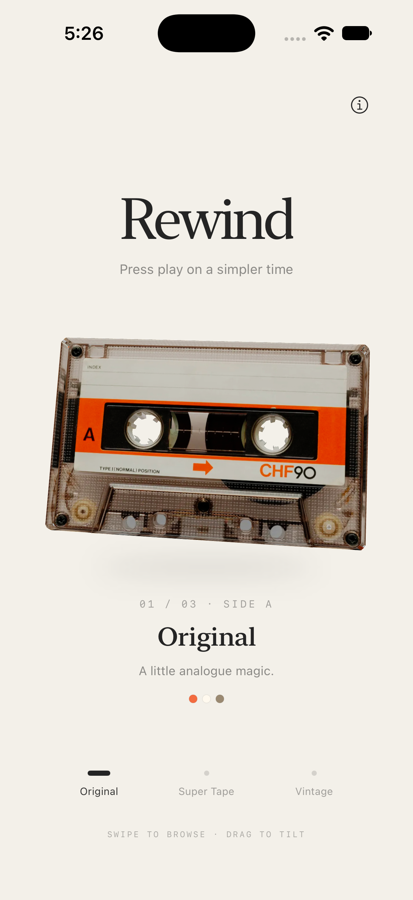
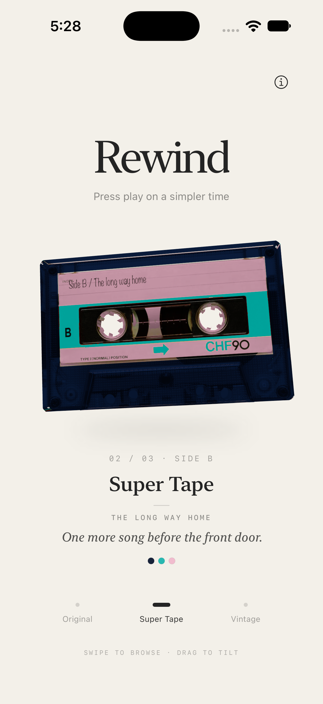

# Wee Interactions / 002 — Rewind

**Press play on a simpler time.**

A playful native iOS cassette collection built with SwiftUI and RealityKit. Swipe through three themed tapes, drag to tilt, and tap to flip between Side A and Side B. Each side reveals a short fictional memory, accompanied by moving reel hubs, a quiet mechanical click and a restrained haptic.

 

## The experience

- **Original:** soft, gently springy motion.
- **Super Tape:** a slightly quicker, tighter response.
- **Vintage:** calmer floating, slower reels and a more relaxed settle.
- One full entrance turn when browsing, with a small spring finish. Taps turn the cassette over by half a turn.
- Handwritten Side B labels and a different memory on each side. The details shift naturally as the memory appears; browsing away clears the caption.
- Independently rotating reel hubs accelerate and coast to a stop. Repeated taps restart them without resetting their angle.
- An original, preloaded mechanical click respects silent mode and mixes with other audio. The info sheet includes a persistent Sound effects toggle.
- VoiceOver actions and side labels, plus reduced spatial motion when Reduce Motion is enabled.

This is a small tactile experiment: no music library, streaming, backend or web views.

## Run

Open `Rewind.xcodeproj`, select the **Rewind** scheme and an iPhone simulator, then Run.

- Deployment target: iOS 18+
- Built and checked with Xcode 27.1 / iOS 27 Simulator
- No third-party app dependencies

For a physical iPhone, choose your own development team under Signing & Capabilities before running. This project is separate from Little Dice, with bundle identifier `studio.weeinteractions.Rewind`.

## Interaction details

Short drags tilt the tape. A horizontal drag over 65 points, or a flick over 24 points with projected travel over 140 points, selects an adjacent tape. The collection stops at each end. Theme buttons provide direct selection.

An accepted tap triggers the dip, flip, reel motion, click and haptic. A 0.35-second cooldown keeps repeated taps controlled. Each tape remembers its current side while browsing during the session. The memory appears after a short delay, guarded against intervening side or theme changes. Reduce Motion snaps the flip and fades the caption.

All six memories are authored sample vignettes, not retrieved personal memories. There are no network calls or user-data storage beyond the local sound preference.

## Implementation

| File | Purpose |
|---|---|
| `Rewind/RewindApp.swift` | SwiftUI layout, gestures, memories, side state, audio and credits |
| `Rewind/CassetteScene.swift` | Async asset loading, non-AR scene, spring motion, flips and reels |
| `Rewind/TapePersonality.swift` | Shared motion curves and subtle per-theme tuning |
| `Rewind/Resources/` | Original model, animated derivative, themed atlases and click |
| `Tools/` | Reproducible asset/sound preparation and focused motion checks |

The source cassette has a baked photographic texture; its transparent appearance is painted rather than physically translucent. The derivative splits the inner reel hubs from the shell and separates back-facing surfaces for readable Side B artwork. Original source geometry and artwork remain available in the untouched source USDZ.

The app caches all three cassettes and their materials. Independent per-tape state keeps reel animation and flips coherent while browsing. Movement pauses while inactive. Asset loading includes a progress indicator, cancellation and retry state.

## Verification

The project builds for Simulator. Manual simulator checks cover the three themes, tap/drag/swipe interaction, flips, labels, memories, rapid switching and the sound toggle. The adapted USDZ passes Apple’s `usdchecker --arkit` validation.

The shared scheme includes UI tests for both sides of each theme, navigation boundaries, memory cancellation, load retry and the persistent sound preference. Run them with Product → Test in Xcode. See the verification record for the latest device-specific results.

The app includes a custom cassette icon and warm launch background. Icon generation details are in [Design/AppIcon.md](Design/AppIcon.md).

Run the focused motion checks from this directory:

```sh
swiftc Rewind/TapePersonality.swift Tools/check_personalities.swift -o /tmp/check-rewind
/tmp/check-rewind
```

These check one-turn bounds, spring continuity, final rest and restrained motion/audio/haptic ranges. See [VERIFICATION.md](VERIFICATION.md) for the full record and limits. Physical haptic feel, silent-switch behavior and sustained performance need hands-on review of the current build. Simulator recordings remain local and are excluded from Git.

Asset preparation scripts use Apple’s USD tools. `make_side_b.py` additionally requires Pillow and the indicated macOS fonts. Generated app assets are already included, so these scripts are not needed to run the app.

## Credits

Made by **Tajdid Rahman**.

Cassette model: [“Psx Style Cassette Tape” by pixapexel](https://sketchfab.com/3d-models/psx-style-cassette-tape-f56e93a81751426e90f772c29039bd08), licensed under [CC BY 4.0](https://creativecommons.org/licenses/by/4.0/). Geometry separation, themed atlases and Side B notes are adaptations. The tap click is an original procedural sound with no third-party samples.

See [ATTRIBUTION.md](ATTRIBUTION.md), [ASSET-ASSESSMENT.md](ASSET-ASSESSMENT.md) and [SOUND-SOURCES.md](SOUND-SOURCES.md) for provenance and sound-replacement guidance.
